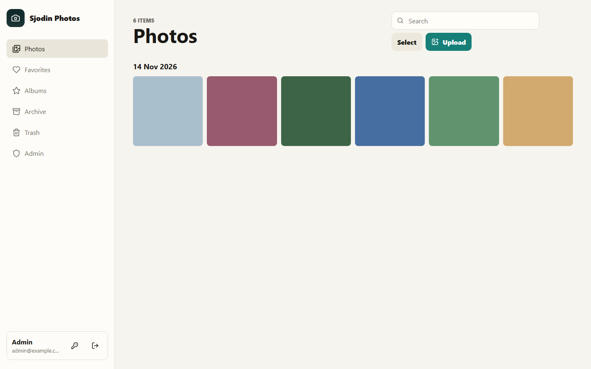
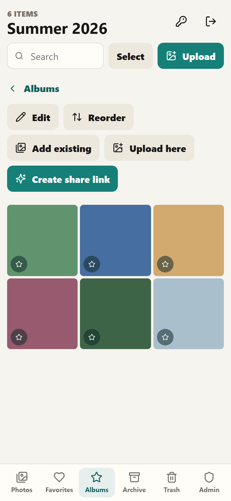

# Sjodin Photos — self-hosted photo and video library

[](https://github.com/matssjodin/photos.matssjodin.com/actions/workflows/ci.yml)

**Sjodin Photos is a lightweight, self-hosted alternative to Google Photos**: a private photo and video gallery for you and your family that runs as a single Docker container. There is no separate database server and no cloud account — just an embedded SQLite database and files on your own disk.

Upload from your phone or computer, organise photos into albums, share an album with a public link, and stream videos — all from a mobile-first web app you can install on your home screen (PWA).

The product name is configurable, so it also works as a **white-label photo gallery** for a club, studio, or client (see [White-label branding](#white-label-branding)).



<p>
  
</p>

*Screenshots use generated placeholder images.*

## Contents

- [Who it is for](#who-it-is-for)
- [Quick start with Docker](#quick-start-with-docker)
- [Features](#features)
- [Tech stack](#tech-stack)
- [Local development](#local-development)
- [Configuration](#configuration)
- [Deployment](#deployment)
- [Storage model](#storage-model)
- [Backups](#backups)
- [FAQ](#faq)

## Who it is for

- **Families and small groups** who want a private photo library on their own server, VPS, NAS, or home lab instead of a cloud photo service.
- **People who want something small.** One container and one data folder. No Postgres, Redis, or machine-learning services to run.
- **Anyone who shares albums** with relatives or clients through a simple link, without asking them to create an account.

It is deliberately not a full archive tool: uploads are converted to space-efficient WebP (photos) and H.264 (videos), and the uploaded originals are not kept. If you need full-resolution originals, RAW files, face recognition, or map views, a larger project such as Immich or PhotoPrism is a better fit.

## Quick start with Docker

```bash
git clone https://github.com/matssjodin/photos.matssjodin.com.git
cd photos.matssjodin.com
docker build -t sjodin-photos .

docker run -d --name sjodin-photos \
  -p 4000:4000 \
  -v sjodin-photos-data:/app/data \
  -e ADMIN_EMAIL=you@example.com \
  -e ADMIN_PASSWORD='choose-a-long-password' \
  sjodin-photos
```

Open <http://localhost:4000> and sign in with the admin email and password you set. Add more users from the **Admin** screen.

For anything beyond `localhost`, put the app behind HTTPS (a reverse proxy such as Caddy, Traefik, or nginx): the session cookie is marked `Secure` in production, so browsers will not send it over plain HTTP. See [Deployment](#deployment).

## Features

**Photo library**

- Drag-and-drop or picker uploads with a combined progress bar; large batches are split automatically into requests that stay under proxy limits (for example Cloudflare's 100 MB cap)
- Photos are stored as two WebP files — a 2048 px display version and a 560 px thumbnail — which keeps disk use small
- SHA-256 duplicate detection: re-uploading the same file is skipped (or restores it from the trash) instead of being stored twice
- EXIF capture date and auto-rotation applied on upload; the library is grouped by day
- Favorites, archive, and trash, with automatic purge of trashed items after a configurable number of days
- Search by filename or date
- Bulk select (long-press on touch) with add-to-album, favorite, archive, zip download, and trash
- Optional description (caption) per photo, shown in the viewer and on shared albums

**Video**

- Upload videos alongside photos; they are transcoded in the background to 1080p and 480p H.264/AAC
- Adaptive HLS streaming with automatic quality switching, plus a plain MP4 fallback
- Custom player with scrub-bar thumbnail previews, playback speed, quality menu, fullscreen, and keyboard shortcuts
- ffmpeg is bundled — nothing extra to install on the host

**Albums and sharing**

- Albums with cover photos, drag-and-drop manual ordering, and "select whole day" picking when adding existing photos
- Share an album through an unguessable public link (`/share/<token>`); visitors need no account and get no download-original button
- Stop sharing at any time — the link dies immediately and nothing is deleted
- Rename or delete an album, optionally moving its photos to the trash

**Viewer**

- Opens instantly with a blurred placeholder, then loads the full image
- Swipe to navigate, swipe down to close, pinch or double-tap to zoom and pan
- Keyboard navigation on desktop (arrow keys, Escape)
- Info panel with date, size, dimensions, description, and download

**Mobile app experience (PWA)**

- Installable on Android, iOS, and desktop with an offline app shell
- Android share target: share photos or videos from any app straight into your library
- The hardware back button closes the viewer, album, or dialog instead of leaving the app
- Mobile-first layout: bottom tab bar on phones, sidebar on desktop

**Accounts and security**

- Multi-user with `admin` and `user` roles; users are created by an admin (no public sign-up)
- Users can change their own password; admins can reset a password from the Admin screen
- PBKDF2-hashed passwords, server-side sessions in `HttpOnly` cookies, login rate limiting per IP and per account
- CSRF origin guard, Content-Security-Policy and other security headers, and an ownership check on every photo and album route
- Shared images are re-encoded, so EXIF metadata such as GPS location is not exposed to visitors

## Tech stack

- **Server:** Node.js 24, Express 5, TypeScript, SQLite via Node's built-in `node:sqlite`
- **Media:** `sharp` (libvips) for images, bundled `ffmpeg` for video transcoding and HLS
- **Client:** React 19 single-page app built with Vite, `hls.js` for adaptive video
- **Packaging:** multi-stage Dockerfile, Docker Compose file, GitHub Actions CI

## Local development

Requires Node.js 24 or newer.

```bash
npm install
npm run dev
```

Frontend: <http://localhost:5173> (Vite, proxies `/api` to the server)
API: <http://localhost:4000>

In development, if no users exist, the server creates `admin@example.com` / `change-me-before-deploy`.

```bash
npm run typecheck   # Type checking for client and server
npm test            # Smoke/integration tests (boots the real server against a temp DATA_DIR)
npm run build       # Production build into dist-server/ and dist-client/
npm start           # Run the compiled server
```

CI runs typecheck, build, tests, and a production-dependency audit on every push and pull request (`.github/workflows/ci.yml`).

## Configuration

All configuration is via environment variables. Copy `.env.example` to `.env` for local use.

### Core

| Variable | Default | Purpose |
|---|---|---|
| `PORT` | `4000` | Server port |
| `DATA_DIR` | `./data` | Root for the SQLite database and all photo files |
| `APP_ORIGIN` | — | Public origin the browser hits (e.g. `https://photos.example.com`). The CSRF guard accepts requests from this origin |
| `TRUST_PROXY` | `1` | Number of reverse proxies in front of the app (Express `trust proxy` hop count). Decides which `X-Forwarded-For` entry counts as the client IP for login rate limiting — e.g. `2` behind Cloudflare + Coolify's proxy. Too high lets clients spoof their IP |
| `ADMIN_EMAIL` / `ADMIN_PASSWORD` | — | The admin account, reconciled on every startup (created, enabled, made admin, password set) |

On startup the server ensures the `ADMIN_EMAIL`/`ADMIN_PASSWORD` account exists and matches — so for that account the environment value wins after a restart, even if the password was changed in the app. In production the server **refuses to start** with no users and no admin variables — it never creates a default account.

### White-label branding

The product name is not hard-coded. Set these to rebrand the whole app — UI, login screen, shared album pages, browser tab title, and the installable PWA — without touching the code:

| Variable | Default | Purpose |
|---|---|---|
| `APP_NAME` | `Sjodin Photos` | Display name shown in the sidebar, login screen, shared pages, page title, and PWA manifest |
| `APP_SHORT_NAME` | `Photos` | Short label under the home-screen icon when installed as a PWA |
| `ATTRIBUTION_TEXT` | `Photoalbum by Mats Sjödin` | Subtle footer link on shared album pages. Set to an empty string to hide the footer |
| `ATTRIBUTION_URL` | `https://matssjodin.com` | Where the footer link points |

To complete a rebrand, also replace the icons in `public/icons/` (or regenerate them with `node scripts/make-icons.mjs`).

### Uploads and maintenance

| Variable | Default | Purpose |
|---|---|---|
| `MAX_UPLOAD_FILES` | `500` | Max files per upload request |
| `MAX_UPLOAD_FILE_SIZE_MB` | `120` | Max size per uploaded image |
| `MAX_UPLOAD_VIDEO_SIZE_MB` | `2048` | Max size per uploaded video |
| `INGEST_CONCURRENCY` | `3` | Parallel image-processing workers during upload (CPU-bound — lower it on small servers) |
| `TRASH_RETENTION_DAYS` | `30` | Days before trashed items are permanently purged (`0` disables auto-purge) |

### Video transcoding

| Variable | Default | Purpose |
|---|---|---|
| `VIDEO_CONCURRENCY` | `1` | Parallel ffmpeg transcodes in the background queue |
| `VIDEO_PRESET` | `medium` | x264 preset (e.g. `fast`, `slow`) — speed versus compression |
| `VIDEO_HD_CRF` / `VIDEO_SD_CRF` | `23` / `26` | Quality target for the 1080p / 480p versions (lower is better and larger) |
| `VIDEO_HD_MAXRATE_KBPS` / `VIDEO_SD_MAXRATE_KBPS` | `6000` / `1500` | Peak bitrate cap for each version — lower these if playback stutters on limited upload bandwidth |

Video settings apply to new uploads only; the uploaded source is discarded after transcoding.

## Deployment

### Coolify (or any Docker host)

Deploy the repository as a Docker app. The database is embedded SQLite — no separate database service is needed.

```bash
PORT=4000
DATA_DIR=/app/data
ADMIN_EMAIL=<your admin email>
ADMIN_PASSWORD=<your first admin password>
APP_ORIGIN=https://photos.example.com
TRUST_PROXY=1
APP_NAME=Sjodin Photos
APP_SHORT_NAME=Photos
```

Mount persistent storage at `/app/data`. The SQLite database and every photo live there:

```text
/app/data/photos.sqlite
/app/data/uploads/
```

**Do not deploy without persistent storage** — recreating the container would otherwise erase all users, albums, and photos.

### Docker Compose

```bash
cp .env.example .env     # set ADMIN_EMAIL, ADMIN_PASSWORD and APP_ORIGIN
docker compose up -d --build
```

### Reverse proxies and Cloudflare

The app works behind any reverse proxy. Practical notes:

- Set `TRUST_PROXY` to the number of proxies between the internet and the app so login rate limiting sees the real client address.
- The Node server keeps idle keep-alive connections open for 185 s so it never closes a pooled connection before the proxy does.
- Behind Cloudflare's proxy, each request is limited to 100 MB. Photo batches are split below this automatically, but a single video larger than 100 MB cannot be uploaded through the proxy. Use a DNS-only (gray-cloud) record for the photos hostname if you need larger videos, or if shared albums load slowly through Cloudflare while the origin is fast.

## Storage model

Each photo is stored under `DATA_DIR/uploads/<userId>/<assetId>/` as exactly two files:

- `preview.webp` — max 2048 px on the longer side, what viewers and downloads receive
- `thumb.webp` — 560 px thumbnail for grids

Videos are stored in the same folder as `video_1080.mp4` and `video_480.mp4` (which double as the HLS media files), a poster image, and a scrub-preview sprite.

Uploaded originals are discarded after conversion, so keep your master copies elsewhere. Duplicate detection still works across re-uploads because the content hash is computed from the uploaded bytes before conversion.

## Backups

Everything lives in `DATA_DIR`: back up that one folder (or its Docker volume) and you have the whole library. For a consistent database copy while the app is running, use `sqlite3 photos.sqlite ".backup backup.sqlite"` and copy `uploads/` alongside it. The app does not make backups for you.

## FAQ

**Is this a Google Photos replacement?**
For browsing, albums, sharing, and phone uploads, yes. It does not have face recognition, location maps, or automatic background sync from a phone's camera roll — uploads go through the web app or the Android share sheet.

**Does it keep my original files?**
No. Photos are converted to 2048 px WebP and videos to 1080p/480p H.264. This keeps storage small but makes it unsuitable as your only copy of full-resolution originals.

**Do I need a database server?**
No. It uses an embedded SQLite file inside the data folder.

**Can several people use it?**
Yes. Each user has a separate private library. An admin creates the accounts.

**Is there a mobile app?**
There is no app-store app. The web app is an installable PWA: use "Add to Home Screen" (iOS) or "Install app" (Android/desktop).

**How do shared album links work?**
Sharing an album creates a long random link. Anyone with the link can view that album's photos and videos without logging in; nobody can list or guess other albums. Turn sharing off to invalidate the link.

**What hardware does it need?**
Any machine that runs Docker. Photo uploads are light; video transcoding is CPU-heavy, so on a small server keep `VIDEO_CONCURRENCY=1` and consider `VIDEO_PRESET=fast`.
